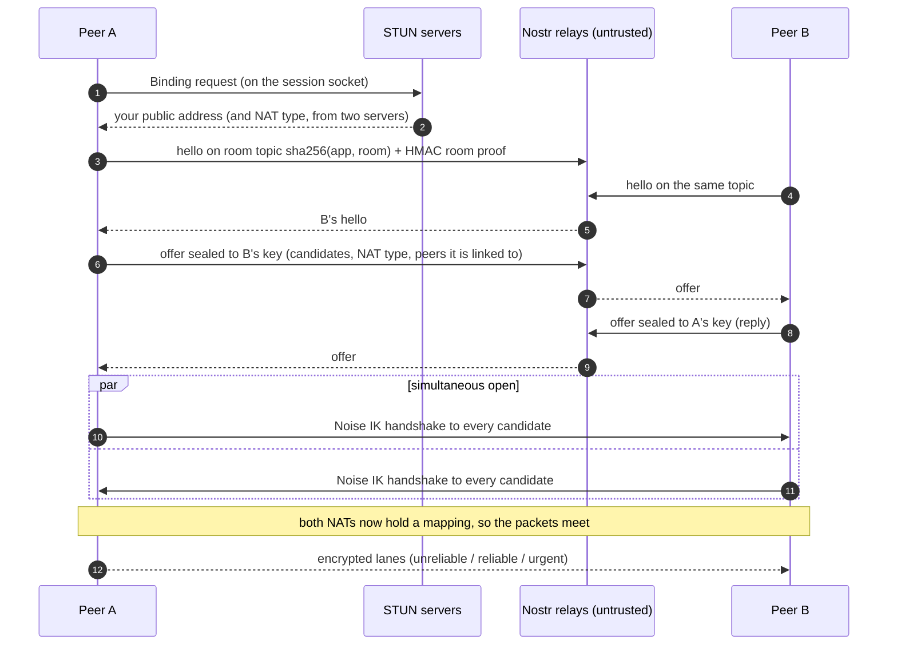

<div align="center">

# Peerwire

**A direct wire between peers.** Peer-to-peer networking for games, whiteboards, meetings and chat:<br>
encrypted, NAT-traversing and real-time, with no server to run and no relay to pay for.

[](https://github.com/avinashid/peerwire/actions/workflows/ci.yml)
[](#license)
[](Cargo.toml)
[](docs/PERFORMANCE.md)
[](docs/GODOT.md)
[](#project-status)

[Quick start](#quick-start) ·
[How it works](#how-it-works) ·
[Low-level design](#low-level-design) ·
[Performance](#performance) ·
[Docs](#documentation) ·
[Contributing](CONTRIBUTING.md)

</div>

---

Peerwire is a networking toolkit written in Rust. Two apps that share a room name or an invite string find each
other, punch through their NATs and open an end-to-end encrypted link. There's no signaling server, TURN server or
backend in between. The same sans-IO core runs natively, in the browser as a 300 KB WebAssembly module, behind a
C ABI and inside Godot 4.

```rust
let mut node = Node::builder().signaling(NostrSignaling::default()).bind("[::]:0")?;
node.join_room("my-game", "9f3c1e7a2b8d4f60a1c5e9b7d3f2a8c4"); // the room name is the password
// ...every other node in the room connects to you, through NAT where it can
```

## Highlights

- **Zero backend.** Peers find each other over pluggable, untrusted signaling: an invite link or QR code, public Nostr relays, or in-process and LAN carriers. STUN learns the public address, and both sides dial at once to punch through. When two NATs can't be punched, any peer connected to both relays the traffic, so no TURN server is needed; for a pair with no such peer, an always-on `peerwire-peer` both keep linked (`Node::set_relay_peers`) is one.
- **Encrypted, key-addressed.** A `PeerId` *is* an Ed25519 public key. Every link is a `Noise_IK_25519_ChaChaPoly_BLAKE2s` session, so dialling an ID authenticates whoever answers. Signaling relays, peer relays and NATs in the path can't read or forge traffic.
- **Real-time lanes.** Each link has three lanes. *Unreliable* is for state. *Reliable* is ordered and carries up to 1 MiB, for events. *Urgent* is reliable, goes ahead of queued reliable data and sends every fragment twice, 4 ms apart, for inputs and hits. Selective ACKs, tail-loss probes and delay-based congestion control keep p99 latency low under loss.
- **One core, every platform.** `peerwire-core` never touches sockets, threads or clocks. The same deterministic state machine is driven by a native UDP socket, tokio, a browser WebRTC DataChannel, a C caller or Godot, and replayed exactly by the network simulator.
- **Scales past the mesh.** The game layer splits players into islands of up to 12 along a Hilbert curve. Super-peers bundle each island's traffic, with failover and overload control. 512 players were simulated at a p99 lag of 79 ms.

## Project status

Peerwire is **v0.1 and in early development**. The APIs will change, and nothing is on crates.io or npm yet.

| Component | Status |
|---|---|
| Session core: identity, Noise IK, lanes, congestion control, peer relay, hole punching, invites | ✅ Working, tested |
| `Node` / `AsyncNode`: UDP host, STUN, rooms, `MemoryHub` and Nostr signaling, NAT traversal | ✅ Working, tested |
| Godot 4 `PeerwireMultiplayerPeer` (desktop) | ✅ Working, tested |
| WebAssembly module and JS package (WebRTC transport, Nostr signaling) | ✅ Working, tested in headless browsers |
| Deterministic network simulator and multiplayer arena benchmark | ✅ Working |
| Game layer: fixed-point maths, Hilbert islands, desync detection, lockstep | ✅ Working |
| Mesh size limit and super-peers in the `Node` facade | 🚧 Planned |
| mDNS and DHT signaling | 🚧 Planned |
| `peerwire-sync` (CRDTs), `peerwire-media` (audio and video), `peerwire-store` (offline store-and-forward) | 🚧 Planned |
| Godot on Android, iOS and web; mobile bindings | 🚧 Planned |

NAT behaviour is verified in a simulator that models RFC 4787 NAT types, and over public Nostr relays and STUN on
one host. Carrier-grade NATs on real mobile networks have **not** been tested yet.

## Quick start

### Rust

Add the crate from git:

```toml
[dependencies]
peerwire = { git = "https://github.com/avinashid/peerwire", features = ["nostr"] } # add "tokio" for AsyncNode
```

**Connect by invite.** One side prints an `pw:` string, and the other dials it:

```rust
use peerwire::{Event, Lane, Node};
use std::time::Duration;

fn main() -> Result<(), Box<dyn std::error::Error>> {
    let mut node = Node::bind("[::]:0")?;
    match std::env::args().nth(1) {
        Some(invite) => { node.connect(&invite)?; }   // joiner
        None => println!("{}", node.invite()),        // host: share this string
    }
    loop {
        node.poll();                                  // drain the socket, fire timers, flush sends
        while let Some(event) = node.try_recv_event() {
            match event {
                Event::Connected { peer, .. } => node.send(&peer, Lane::Reliable, b"hello")?,
                Event::Message { peer, data, .. } => println!("{peer}: {}", String::from_utf8_lossy(&data)),
                _ => {}
            }
        }
        std::thread::sleep(node.next_timeout().unwrap_or(Duration::MAX).min(Duration::from_millis(5)));
    }
}
```

**Meet by room name, across NATs.** No invite to pass around. Give the node a signaling carrier and a room:

```rust
use peerwire::{Node, NostrSignaling, Role};

let mut node = Node::builder()
    .signaling(NostrSignaling::default())        // wss://nos.lol, wss://relay.primal.net, wss://nostr.mom
    .bind("[::]:0")?;
node.join_room("my-app", "9f3c1e7a2b8d4f60a1c5e9b7d3f2a8c4");          // full mesh
// node.join_room_as("my-app", room, Role::Host);                     // or a star: one host,
// node.join_room_as("my-app", room, Role::Client);                   //   many clients
println!("public address {:?}, NAT {:?}", node.public_addr(), node.nat_type());
```

> [!IMPORTANT]
> **The room name is the room's password.** Relays only see a hash of it. Only peers that know the name can join,
> or act as the host. Use a name with at least 128 random bits (32 hex digits, or 22+ base64 characters) for a
> private room: relays see an unsalted hash of it, which anyone can test guesses against offline. A guessable name
> makes a public lobby.

Run the bundled examples:

```sh
cargo run --release -p peerwire --example echo                 # prints an pw: invite
cargo run --release -p peerwire --example echo -- pw:...       # second terminal: join, echo
cargo run --release -p peerwire --example echo_async --features tokio
cargo run --release -p peerwire-core --example udp_pair        # core alone, UDP loopback
cargo run --release -p peerwire-sim --example arena -- --players 512 --supers 8
```

### Godot 4

`PeerwireMultiplayerPeer` is a drop-in `MultiplayerPeer`. `@rpc`, `MultiplayerSynchronizer` and
`MultiplayerSpawner` work unchanged:

```gdscript
var peer := PeerwireMultiplayerPeer.new()
peer.host_room("my-game", "9f3c1e7a2b8d4f60a1c5e9b7d3f2a8c4")   # on the host
# peer.join_room("my-game", "9f3c1e7a2b8d4f60a1c5e9b7d3f2a8c4") # on each player
multiplayer.multiplayer_peer = peer
```

Build it with `cargo build --release -p peerwire-godot`. See [docs/GODOT.md](docs/GODOT.md) for installation, the
full API and the demo project in [`examples/godot`](examples/godot).

### Browser and JavaScript

```sh
./packages/js/build.sh                       # -> packages/js/pkg/peerwire_ffi.wasm
python3 -m http.server -d packages/js 8000   # open http://localhost:8000/demo/ in two tabs
```

```js
import { joinRoom } from '@peerwire/js';   // packages/js/src/index.js

const room = await joinRoom({ appId: 'my-app', roomId: 'lobby', signaling: 'nostr' });
room.on('message', (data, peer) => console.log(peer.slice(0, 6), data));
room.send('hello');                     // every joined peer; room.poll() for game loops
```

[`packages/js/README.md`](packages/js/README.md) has the full API, the privacy modes and the lower layers
(`loadPeerwire`, `WebRtcTransport`, `NostrSignaling`).

For React, [`@peerwire/react`](packages/react/README.md) wraps a room in hooks, with TypeScript types:
`<RoomProvider>`, `usePeers`, `useMessages`, `useSharedState` (one value for the whole room) and `usePeerState`
(each member's live value, such as a cursor).

## How it works

Two peers that have never met connect in four steps. Signaling only carries addresses, and the link itself is
authenticated end to end.



1. **Learn your address.** STUN runs on the session's own UDP socket, so the reflexive address it reports is the
   real mapping the link will use. Comparing two servers classifies the NAT as `Open`, `Cone` or `Symmetric`.
2. **Find each other.** Peers announce themselves on a room topic over an untrusted publish/subscribe carrier.
   The carrier sees only hashes and PeerIds, never addresses.
3. **Swap candidates privately.** Each peer seals its candidate addresses to the other's public key, so only the
   intended peer can read them.
4. **Dial everything at once.** Both sides start the Noise handshake on every candidate path, plus through any
   mutual peer. The first path to finish wins. A relayed link keeps punching in the background and moves to a
   direct path once a punch is confirmed.

## Low-level design

### Architecture

```
 ┌───────────────────────────────── your app ─────────────────────────────────┐
 │ game · whiteboard · meeting · chat                                         │
 ├───────────────────────────── building blocks ──────────────────────────────┤
 │ peerwire-game     fixed-point maths, Hilbert islands, desync detection       │
 │ peerwire-sync · peerwire-media · peerwire-store                    (planned)     │
 ├───────────────────────────── hosts / facades ──────────────────────────────┤
 │ peerwire::Node    UDP socket, STUN, rooms, traversal (+ AsyncNode, tokio)    │
 │ peerwire-godot    PeerwireMultiplayerPeer (GDExtension)                        │
 │ peerwire-ffi      C ABI → wasm (browsers, Node) and native libraries         │
 │ peerwire-sim      deterministic network and NAT simulator                    │
 ├────────────────────────── peerwire-core (sans-IO) ───────────────────────────┤
 │ Endpoint: sessions · Noise IK · lanes · ACK + congestion control ·         │
 │ tail-loss probe · keepalive · roaming · peer relay · hole punch · invites  │
 ├────────────────────────── signaling (untrusted) ───────────────────────────┤
 │ invite / QR · MemoryHub · Nostr relays · BroadcastChannel (JS) ·           │
 │ mDNS, DHT (planned)                                                        │
 └────────────────────────────────────────────────────────────────────────────┘
```

### The sans-IO core

`peerwire_core::Endpoint<A>` is a pure state machine, generic over the address type `A`. It owns no socket, thread,
clock or RNG of its own (the RNG is seeded once at construction). A host drives it with five calls:

```text
  incoming                                     outgoing
  ────────                                     ────────
  datagram ─► handle_datagram(now, from, bytes)
  timer    ─► handle_timeout(now)
                 poll_transmit(now) ─► (dst, bytes) ─► socket
                 poll_event()       ─► Event        ─► app
                 poll_timeout()     ─► when to wake up next

  The host loop is Node, AsyncNode, the FFI / JS glue, Godot or the simulator.
```

Because time and I/O come from outside:

- `peerwire-sim` replays any scenario bit for bit, covering latency, jitter, loss, router buffers, uplink caps and
  eight NAT behaviours.
- The wasm build needs **zero imports**, and the same binary runs in browsers and in Node.
- Every platform gets identical protocol behaviour, because there is only one implementation.

Events: `Connected { peer, path, initiator }`, `Message { peer, lane, data }`, `Disconnected { peer, reason }`,
`ConnectFailed { peer }`, `PathChanged { peer, path }` (relayed ↔ direct, or roaming) and
`AddrObserved { by, addr }` (the address a peer sees you at).

### Identity and handshake

- **Identity.** An Ed25519 key pair. A `PeerId` is the 32-byte public key. Its X25519 (Montgomery) form is the
  Noise static key, so one key both signs and handshakes.
- **Handshake.** `Noise_IK_25519_ChaChaPoly_BLAKE2s` with the prologue `peerwire-core/1`. The initiator already knows
  the responder's static key, which is the PeerId it dialled, so the handshake takes **one round trip** and nobody
  can answer in the target's place. The handshake retries every 500 ms and gives up after 10 s.
- **Simultaneous dials.** When both sides dial at once, as hole punching requires, the dial from the smaller
  PeerId wins, so exactly one session results.
- **Data packets.** ChaCha20-Poly1305 with an explicit 64-bit nonce, and a 2048-packet sliding anti-replay window,
  as in WireGuard.

### Wire format

All integers are little-endian. All parsing is bounds-checked and allocation-free. A datagram is at most
**1232 bytes**, the IPv6 minimum MTU minus headers, so it is never fragmented by IP.

```text
packet = kind(u8: version<<4 | type) ...
  HS1    kind  sender_idx(u32)                     noise_msg1
  HS2    kind  sender_idx(u32)  receiver_idx(u32)  noise_msg2
  DATA   kind  receiver_idx(u32) nonce(u64)        AEAD(frames)  +16 B tag

frames (inside DATA, several per packet):
  PING                                  keepalive / liveness probe
  ACK       cum(u32) bits(u64)          cumulative + 64-bit selective ACK
  REL       seq(u32) flags(u8) len(u16) data      reliable fragment (≤ 1100 B)
  UNREL     len(u16) data                          unreliable message (≤ 1100 B)
  CLOSE
  OBSERVED  alen(u8) addr               "I see you at addr" (reflexive address)
  FWD       to(32) len(u16) packet      relay: please forward this packet to peer `to`
  FWD_QUIET to(32) len(u16) packet      the same, without telling `to` my address (relay-only)
  RELAYED   alen(u8) addr len(u16) packet   relayed packet + where the relay saw its origin
  PUNCH     token(u64) / PUNCH_ACK token(u64)   hole-punch probe and its echo
```

The overhead is 13 B of header and a 16 B tag per packet, plus 3 B (unreliable) or 8 B (reliable) per message. A
message costs about **`s + 60` bytes** natively over IPv4. Messages sent in the same tick share one packet.
A peer that doesn't know a frame type (an older build, before `FWD_QUIET`) takes it as a protocol violation and
drops the link: builds before 1.0 don't promise to interoperate.

### Lanes and reliability

| Lane | Guarantee | Size | Use for |
|---|---|---|---|
| `Unreliable` | at most once, drop-oldest | ≤ 1100 B | positions, cursors, voice activity |
| `Reliable` | ordered, exactly once, fragmented | ≤ 1 MiB | chat, document ops, game events |
| `Urgent` | exactly once, ordered among urgent messages, ahead of queued `Reliable` data; every fragment sent twice, 4 ms apart | ≤ 1 MiB | inputs, hits: anything where p99 beats bytes |

The reliable lane is a small, real-time-tuned transport:

- **Selective ACKs.** A cumulative ACK plus a 64-bit bitmap. Fragments 3 sequence numbers behind the highest ACK
  are fast-retransmitted without waiting for a timeout, once per loss: only an ACK for a fragment sent after the
  last copy counts, and a quarter of the minimum RTT is allowed for reordering (as in RACK) before resending.
- **RTO.** Initial 300 ms, bounded to 20 ms–5 s, with backoff capped at 10 s. A 25 ms ACK-delay allowance (as in
  QUIC's `max_ack_delay`) covers busy game frames and browser event loops. A fragment is declared dead after 16
  sends. While a hole is repaired, fragments more than 64 above it (beyond the bitmap's reach) don't time out
  before the repair does.
- **Tail-loss probe.** If nothing is acknowledged for `srtt + 2·rttvar + 4 ms`, the newest fragment is resent.
  A lost tail is repaired in about one RTT instead of a full RTO, which matters for sparse traffic such as a lone
  event.
- **Congestion control.** The window starts at 16 fragments, with a floor of 4. It backs off on loss, and also when
  queueing delay (RTT above the minimum seen) passes **25 ms**, before any loss. That keeps router and DataChannel
  buffers short for real-time traffic.
- **Receive window.** 1024 out-of-order fragments are buffered ahead of the next expected one.
- **Liveness.** A keepalive goes out every 10 s, and a link is dropped after 30 s of silence. Links survive address
  changes (roaming), and `PathChanged` reports the move.

### NAT traversal

Details are in [docs/NAT-TRAVERSAL.md](docs/NAT-TRAVERSAL.md).

| Piece | Design |
|---|---|
| **STUN** | Binding requests go out on the session socket, every 25 s, which also keeps the mapping alive. The defaults are `stun.l.google.com:19302` and `stun.cloudflare.com:3478`. An answer counts only if it comes from the queried server and echoes the random 96-bit transaction id. The first byte (RFC 7983) separates STUN from session traffic. |
| **Signaling** | `trait Signaling { subscribe, unsubscribe, publish, poll }` over 32-byte topics. `MemoryHub` runs in-process. `NostrSignaling` (feature `nostr`) sends ephemeral events of kind 25059 over websocket relays: `wss://` uses rustls with the webpki roots. The NIP-01 event id is checked before deduplication. Frames above 128 KiB are rejected, and the queue is capped at 1024 events. |
| **Topics** | Room topic: `sha256("peerwire/room/" + app + "/" + room)`. Inbox: `sha256("peerwire/peer/" + hex(PeerId))`. These are the same derivations as the JS package, so Rust and browser peers can share relays. |
| **Room key** | `sha256("peerwire/room-key/" + app + "/" + room)` is a different label over the same name, so it can't be derived from the topic. Hellos (with the sender's clock, ±60 s) and offers carry HMAC-SHA256 proofs under it. Forged or stale ones are dropped before they cost anything. |
| **Offers** | `Noise_X` sealed boxes to one recipient, with the sender authenticated. Each carries up to 8 candidate addresses (as the [privacy mode](#privacy-modes) allows; one slot may hold a port prediction instead), the NAT type, up to 8 connected peers (possible relays), a timestamp (±60 s), a random nonce (replays are dropped) and an HMAC proof: under the room key in a room, or under the recipient's invite key. A node acts on an offer only with a valid proof, or from a peer it dialled itself. |
| **Punching** | Both sides call `connect_with` on every *dialable* candidate at the same moment. Loopback, unspecified, multicast and broadcast addresses are refused, so an offer can't aim a node at its own host's services. PUNCH probes go every 100 ms for 5 s. A path counts as direct only after an echoed `PUNCH_ACK`. |
| **Port prediction** | A symmetric NAT whose two STUN mappings are 1–8 ports apart looks sequential: its offer predicts the next port, and a cone peer also probes 32 ports around it, three times (first handshake sends while dialling, punch rounds while relayed). Old decoders skip the entry. |
| **Birthday punching** | A symmetric NAT with random ports against a cone that filters by port: the symmetric side opens 256 extra sockets towards the cone, and the cone sprays up to 2048 ports of its IP until one probe lands on a socket's mapping (theoretical odds 99.97%). Automatic, once per peer per 5 minutes; also moves a relayed link to direct. |
| **Lockstep prediction** | Two symmetric NATs that both hand out ports in sequence probe each other's predicted ports in order, one side at every step and the other at every second, so their new mappings line up even when each NAT gave out up to about 31 ports since its prediction. |
| **Port mapping** | Opt-in (`Builder::port_mapping`). The router forwards a public UDP port to the socket, by PCP, then NAT-PMP, then UPnP-IGD. The mapping is renewed at half its lease and deleted on drop. It is offered after the STUN address, and only if the router's own address is public: behind CGNAT it isn't offered (`PortMapping::NotPublic`). |
| **Relay fallback** | If no direct path opens, as between two symmetric NATs, the link runs `Path::Via(peer)` through a mutual peer. The relay forwards only ciphertext: `FWD` and `RELAYED` frames wrap the end-to-end packet. The link keeps trying to go direct. |
| **Abuse limits** | Hellos answered and offers acted on each have a token budget: a burst of 30, then one every 2 s. Each sender also has its own limit: a burst of 8, then one per second. Proofs are checked before any token is spent, and answers from peers a node dialled itself don't draw on the node's budget. |

**Simulated outcome.** In a room of two with signaling only, **59 of 64** NAT-type pairings connect directly, in
360–860 ms, 1.5 s for the four that need lockstep prediction, or 2–4.3 s for the four that need a birthday punch
(43 before port prediction, 51 before birthday punching, 55 before lockstep prediction). These pairings cover
public, full-cone, restricted, port-restricted, sequential and random symmetric, and two CGNAT stacks. The rest
are a random-port symmetric NAT against another symmetric one; they are reported as `Symmetric`, naming the
symmetric side. In a room with a third peer they connect relayed through it.

### Invites

```text
"pw:" base64url( version(1)=2  peer(32)  key(32)  n(u8) [alen(u8) addr]*  m(u8) [relay_peer(32) alen(u8) addr]* )
```

An invite is a public key, some places to try it, and an *invite key*. Whoever answers must prove they hold the
public key in the handshake. `Node::connect` dials the invite's addresses and also sends the host a sealed offer,
proved with the invite key, so the host dials back at the same moment and the two punch through. The invite key is
what makes the host dial back: someone who knows only its PeerId gets no answer and no address. Version 1 (no key)
still parses; such an invite works only where the host is reachable without a dial-back.

### Privacy modes

Peers linked directly see each other's IP address: their packets carry it. A node picks what it gives out with
`Builder::privacy` or, at runtime, `Node::set_privacy` (the next invites and offers change; links already up stay
as they are):

| Mode | Invites and offers carry | Links | Cost |
|---|---|---|---|
| `Privacy::Direct` (default) | every candidate: public, LAN, loopback | direct where possible | none |
| `Privacy::PublicOnly` | public addresses only, no LAN, loopback, CGNAT or link-local | direct where possible | peers on one LAN go through their NAT (if it hairpins) or a relay |
| `Privacy::RelayOnly { via }` | nothing; the relay (`via`, or the room host: the pinned one, else the first that proved its role) gets the public addresses | every link but the relay's goes `Path::Via(relay)` and never punches to direct; `connect` fails with `ConnectError::NoRelay` rather than going direct | latency `rtt(A,R) + rtt(R,B)` instead of `rtt(A,B)`; the relay uploads every relayed byte again, capped at `Config::relay_rate` (256 KiB/s) per peer |

Under `RelayOnly` the relay sees both ends' addresses (it links to both directly), and is asked, with `FWD_QUIET`,
not to tell the far end where it sees this node. A relay-only node's invite names its relay with the relay's
address, so whoever holds the invite learns the relay's (the host's) IP. In a room without a pinned host
(`join_room_with(.., Some(host))`, Godot `join_room_host`) the relay is whichever member first proves the Host role
and is dialled: anyone who knows the room name can claim it and learn this node's IP. It stays the relay while its
link is up, so pin the host when its key is known. In the simulator (`privacy_modes_matrix`, a room with a public host
and 37 pairs of peers): Direct links 25 pairs directly and relays 12, PublicOnly 24 and 13 (the LAN pair goes through
the host), RelayOnly 0 and 37. None fail. In the Godot binding, players link only with the host anyway, so they
never see each other's addresses in any mode. Browsers: `privacy: 'public-only'` drops `host` ICE candidates;
`'relay-only'` opens WebRTC to the relay only (there is no TURN).

### Security model

| Party | Can see | Cannot do |
|---|---|---|
| Signaling relay, or anyone watching it | room and inbox topics (hashes), the PeerIds and roles in hellos, timing, source IPs | read offers or addresses, join a room or pose as its host without the name, forge a link |
| Anyone who knows a PeerId (not the invite) | the PeerId | make the node dial back, or learn its addresses |
| Peer relay (`Path::Via`) | that A and B talk, both their IP addresses, packet sizes and timing | read, modify or inject session traffic |
| On-path attacker | ciphertext | impersonate a PeerId, replay data packets |
| Room member, or invite holder | candidate addresses: all (`Direct`), public only (`PublicOnly`), none (`RelayOnly`, unless it is the relay); the source IP of a direct link. An invite holder the node didn't dial gets public addresses only and none of the node's linked PeerIds in offers, even after its dial failed | pose as another PeerId |

Report vulnerabilities privately: see [SECURITY.md](SECURITY.md).

### Scaling: islands and super-peers

A full mesh costs each peer `(N − 1)` streams. The game layer sorts players along a Hilbert curve into
**islands of at most 12**. Each island has a super-peer, ranked by uplink and NAT type, that bundles members'
inputs into one packet per member per tick:

- **Failover.** Members keep a hot-standby link to the next-ranked candidate and migrate after 2 s without bundles.
- **Overload control.** When measured queue delay exceeds 25 ms, the update interval is raised rather than
  stalling.
- **Rule of thumb.** Players per super-peer ≈ `0.8 × uplink / (60 Hz × ~170 B × 8)`, which gives about 98 players
  on 10 Mbit/s. The simulator measured 96.

## Performance

These figures were measured on a 4-core aarch64 machine and in the deterministic simulator. The full methodology,
the theoretical models and the commands to reproduce them are in [docs/PERFORMANCE.md](docs/PERFORMANCE.md).

| Measurement | Result |
|---|---|
| Reliable messages over UDP loopback, one core | **~1.2 M msg/s** |
| Handshake | **1 RTT** (Noise IK) |
| WebAssembly module | **~300 KB, 0 imports** |
| Two wasm endpoints in Node: connect, then 1000 × 64 B + 64 KiB | connect 53 ms, transfer 51 ms |
| 512 players, 8 super-peers, 60 Hz, 1% loss, 20% symmetric NAT | lag p50/p99 **59/79 ms** |
| Super-peer killed mid-game | detected in 267 ms, 0 stalls, every event delivered |
| Room of two over public Nostr relays + STUN (same host) | connected in < 1 s |

## Platform support

| Platform | How |
|---|---|
| Linux, macOS, Windows (Rust) | `peerwire::Node` (sync) or `AsyncNode` (tokio) |
| Browsers | `peerwire-ffi` → wasm, with WebRTC DataChannels as transport (`packages/js`) |
| Node.js | the same wasm module |
| Godot 4.3+ desktop | `peerwire-godot` GDExtension |
| Swift, Kotlin, Dart, C | `peerwire-ffi` native library (C ABI). Higher-level bindings are planned |
| Docker | an always-on peer is just a node that stays online: `docker compose up` runs one on localhost, with the demos ([docs/DOCKER.md](docs/DOCKER.md)) |

## Repository layout

| Path | What it is |
|---|---|
| [`crates/peerwire-core`](crates/peerwire-core) | Sans-IO session core: identity, Noise IK, lanes, ACK and congestion control, peer relay, hole punching, STUN codec, sealed boxes, invites |
| [`crates/peerwire`](crates/peerwire) | The Rust facade: `Node` and `AsyncNode` on a UDP socket, STUN, rooms, `Signaling` (`MemoryHub`, `NostrSignaling`), NAT traversal |
| [`bindings/godot`](bindings/godot) | Godot 4 GDExtension: `PeerwireMultiplayerPeer` |
| [`crates/peerwire-ffi`](crates/peerwire-ffi) | C ABI: one surface for WebAssembly and native FFI |
| [`crates/peerwire-sim`](crates/peerwire-sim) | Deterministic network simulator (latency, jitter, loss, NAT types, uplink limits) and the arena benchmark |
| [`crates/peerwire-game`](crates/peerwire-game) | Fixed-point maths, Hilbert-curve islands, desync detection, lockstep timing constants |
| [`crates/peerwire-peer`](crates/peerwire-peer) | Optional always-on peer (binary): one identity across restarts, relays for linked peers; see [docs/DOCKER.md](docs/DOCKER.md) |
| [`packages/js`](packages/js) | JavaScript package: wasm glue, WebRTC transport, Nostr signaling, browser demos |
| [`packages/react`](packages/react) | React hooks over `@peerwire/js`, in TypeScript: rooms, members, chat, shared and per-peer state |
| [`examples`](examples) | Rust examples (echo, async echo, a local Nostr relay) and the Godot demo |
| [`docs`](docs) | Architecture, NAT traversal, Godot, Docker, performance, test plan, comparison |
| [`scripts/gate.sh`](scripts/gate.sh) | The release gate: every check a change must pass |

## Building and testing

You need a stable Rust toolchain. Building the wasm module also needs the `wasm32-unknown-unknown` target, and the
JS checks need Node.js.

```sh
cargo build --workspace --release
cargo test  --workspace --release
scripts/gate.sh              # tests, clippy, wasm build + size check, JS glue, headless browser tests
scripts/gate.sh --quick      # skip the browser tests
scripts/gate.sh --strict     # clippy with -D warnings
scripts/gate.sh --nostr      # also the opt-in tests against public Nostr relays and STUN
```

Tests run on loopback, in the simulator or against an in-process Nostr relay
(`cargo run -p peerwire --example nostr_relay --features nostr`). Only `--nostr` reaches the public internet. See
[docs/TEST-PLAN.md](docs/TEST-PLAN.md).

## Documentation

| Document | |
|---|---|
| [Architecture](docs/ARCHITECTURE.md) | principles, layers, connection flow, lanes, super-peers |
| [NAT traversal](docs/NAT-TRAVERSAL.md) | STUN, signaling, rooms and proofs, message formats, rules, threat analysis, coverage |
| [Godot](docs/GODOT.md) | install, API, demo, limits |
| [Docker](docs/DOCKER.md) | the always-on peer, the examples server, settings, exposing them |
| [Performance model](docs/PERFORMANCE.md) | measured and theoretical numbers for games, whiteboards, chat and meetings |
| [Test plan](docs/TEST-PLAN.md) | what is tested, and how |
| [Comparison](docs/COMPARISON.md) | GunJS, Yjs, PeerJS, libp2p, Trystero, Hyperswarm |

## Contributing

Issues and pull requests are welcome. Read [CONTRIBUTING.md](CONTRIBUTING.md) first. Every change must pass
`scripts/gate.sh`. For security issues, follow [SECURITY.md](SECURITY.md) rather than opening a public issue.

## License

Licensed under either of

- Apache License, Version 2.0 ([LICENSE-APACHE](LICENSE-APACHE))
- MIT license ([LICENSE-MIT](LICENSE-MIT))

at your option.

Unless you explicitly state otherwise, any contribution you intentionally submit for inclusion in this work, as
defined in the Apache-2.0 license, is dual licensed as above, without any additional terms or conditions.
